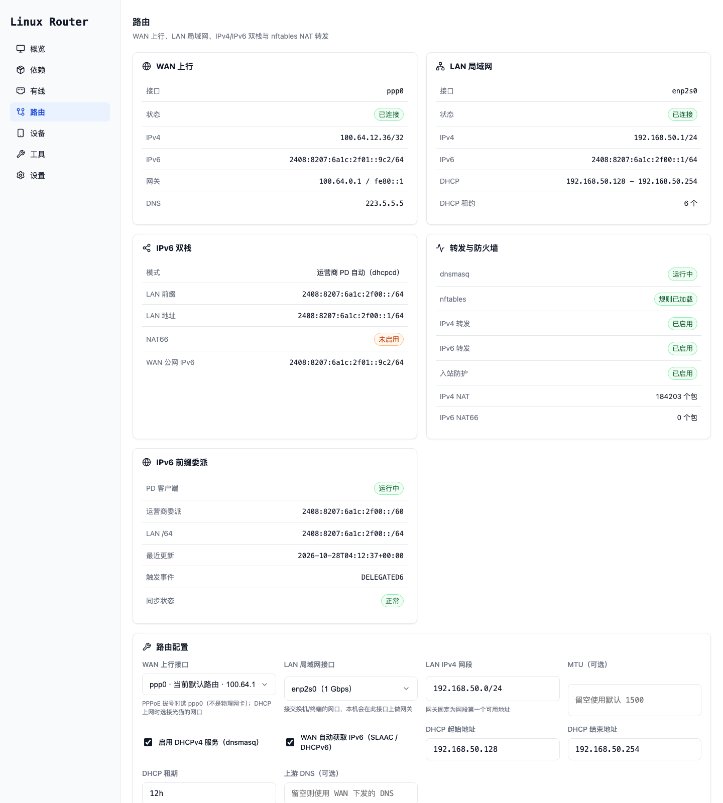

[English](README.md) | **简体中文**

<h1>
  
  Linux Router
</h1>

**把一台 x86 小主机变成纯有线、IPv4/IPv6 双栈的 Debian 路由器，带一个能用的 Web 控制台。**

面向 Debian 13 最小化安装（trixie），只用系统自带或 `apt install` 一个包就能装上的组件：
没有无线、没有 iptables、没有 NetworkManager，转发与 NAT 全部由 nftables 承担。



> 本项目是 [Jaksay/Linux-Router](https://github.com/Jaksay/Linux-Router) 的改造分支，
> 去掉了 Wi-Fi / 热点，换成 Debian 13 自带的 `systemd-networkd` + `nftables` + `dnsmasq`，
> 并补齐双栈、限速、访问控制、备份等家用路由真正需要的功能。

## 功能

| 页面 | 内容 |
| --- | --- |
| 概览 | 主机 / CPU / 内存 / 磁盘 / 运行时间、活动连接（含 IPv6）、网卡硬件信息 |
| 路由 | WAN 连接方式（DHCP / PPPoE）、LAN 网段、DHCP 池与租期、上游 DNS、MTU、IPv6 四种模式、访问控制、一键应用 |
| 有线 | 每块网卡的角色、链路状态、速率、IPv4/IPv6 地址、网关、DNS |
| 设备 | DHCP 租约 + 邻居表合并；**设备备注名**、**静态地址绑定**（按 MAC 固定 IP） |
| 依赖 | 组件 / 服务 / 转发 / NAT / DNS 体检，一键修复，可安装缺失包 |
| 工具 | 服务监控（运行状态 + **开机自启**）、Tailscale、重启 |
| 设置 | 管理员密码、CAKE 限速、**备份与恢复** |

其他要点：

- **IPv6 双栈**：WAN 自动 SLAAC/DHCPv6；LAN 支持运营商前缀委派（PD）、ULA + NAT66、静态全局前缀、关闭
- **CAKE 限速**：按 Mbit/s 填带宽，上行直接整形、下行经 `ifb-lr` 镜像整形，抑制 bufferbloat
- **访问控制**：开放 / 保护两档；保护模式丢弃 WAN 新入站，放行 DHCP、ICMPv6、LAN 与 Tailscale
- **备份恢复**：导出单个 JSON（配置 + 包名清单，不含 .deb），恢复时校验白名单并按需装包
- **零 nmcli**：网络状态全部来自 `ip -j` 与 `/sys`，面板不依赖 NetworkManager

## 与上游的差异

| 方面 | 上游 | 本分支 |
| --- | --- | --- |
| 无线 | Wi-Fi 客户端、热点、AP+STA、热点保活 | **全部移除**，仅有线 |
| 转发 | `iptables` + NetworkManager `shared` | **nftables**，规则由面板生成 |
| IPv6 | 不支持 | **双栈**：PD / ULA+NAT66 / 静态前缀 / 关闭 |
| 网络栈 | NetworkManager | **systemd-networkd** + `pppd`（仅 PPPoE 拨号） |
| DHCP/DNS | `dnsmasq-base` 仅供热点 | `dnsmasq` 作为服务：DHCPv4 + LAN DNS（IPv6 由 networkd 发 RA） |
| 依赖 | `iptables`、`iw`、`wpasupplicant` | 以上全部去掉 |

## 系统要求

- x86_64 设备，至少两个有线网口（WAN / LAN）
- Debian 13 最小化安装（systemd + apt）
- 建议 1 GB 内存、4 GB 磁盘

安装器会装这些包，其余全部来自系统自带：

```text
python3 python3-flask gunicorn systemd dnsmasq nftables iproute2 udev ppp curl tar ca-certificates
```

内核侧的 `nf_tables`、`nf_nat`、`sch_cake`、`ifb` 都是 Debian 内核自带模块，无需编译。

## 安装

> 第一次上机、尤其是**替换现有软路由**时，建议照着 [上机清单](docs/INSTALL-CHECKLIST.md) 走：
> 里面覆盖了最小化安装的 sudo / 用户组问题、DVD 源报错、时间与 DNS、切换与回滚步骤。

### 方式一：加速脚本（国内网络推荐）

`get.sh` 会依次尝试 GitHub 直连和几个公共镜像，拿到 `install.sh` 后自动用同一个镜像下载源码包：

```bash
curl -fsSL https://raw.githubusercontent.com/wangyr2008/Linux-Router/main/get.sh -o /tmp/lr.sh
sudo bash /tmp/lr.sh install
```

如果连 `get.sh` 都拉不下来，可以手动指定镜像（或先想办法把 `get.sh` 拷进去）：

```bash
sudo bash /tmp/lr.sh install --mirror https://ghfast.top/
sudo bash /tmp/lr.sh --list-mirrors          # 查看内置镜像列表
```

### 方式二：本地源码（最稳，不依赖网络）

把仓库压缩包拷到设备上解开，然后：

```bash
cd /root/Linux-Router
sudo bash install.sh install --source-dir /root/Linux-Router
```

安装器会自己识别脚本所在目录就是源码树，`--source-dir` 可以省略。

### 方式三：指定仓库 / 分支

```bash
sudo bash install.sh install --repo https://github.com/<你>/Linux-Router.git --branch main
```

### 安装器做了什么

- 安装依赖包，部署到 `/opt/linux-router`（数据在 `/var/lib/linux-router`），创建 `router-panel` 服务账号
- 写入 `/etc/nftables.d/90-linux-router.nft` 与 `/etc/dnsmasq.d/linux-router.conf` 的引导配置，并确保两个 include 目录已接入主配置
- 开启 IPv4 / IPv6 转发，启用 `nftables`、`dnsmasq`、`systemd-networkd` 和两个面板服务
- **不碰你的网卡**：网口由面板在你点击「应用路由配置」时才接管（会停掉 NetworkManager / dhcpcd / ifupdown 对这些网口的管理）

## 首次配置

浏览器打开 `http://<设备IP>/`，用安装结束打印的 `admin` 密码登录，然后进 **路由** 页：

1. **WAN 连接方式**：光猫桥接选 PPPoE（填宽带账号 + 物理网口）；光猫拨号或上级路由选 DHCP
2. **LAN 接口**：接交换机/终端的那块网卡
3. **LAN IPv4 网段**（默认 `192.168.50.0/24`）、DHCP 池、租期
4. **IPv6 模式**（见下）
5. **访问控制**：见「安全」一节，从 WAN 侧管理面板时务必先填放行端口
6. 点「应用路由配置」

应用会写入 `.network`、dnsmasq 与 nftables 规则并重启相关服务。**如果改了 LAN 地址，当前页面会掉线，用新地址重开即可。**

## 网络架构

| 组件 | 负责 |
| --- | --- |
| `systemd-networkd` | WAN 的 DHCP/SLAAC、LAN 静态地址、IPv6 RA/RDNSS、DHCPv6 前缀委派 |
| `pppd`（`linux-router-pppoe.service`） | 只做 PPPoE 会话，把 `ppp0` 建出来 |
| `dnsmasq` | LAN 的 DHCPv4 与 DNS，只绑定 LAN 地址 |
| `nftables` | NAT、转发、入站过滤（四张 `lr_*` 表） |
| CAKE / `ifb-lr` | 上行整形 + 下行镜像整形 |

NetworkManager、dhcpcd、ifupdown 都不再使用。

### 多网口 LAN（桥接）

工控机一般有 4~6 个网口，路由页的「LAN 网口」是多选：

| 选中数量 | 行为 |
| --- | --- |
| 1 个 | 该网口直接作为 LAN 接口（`lan_interface=<网口>`） |
| 2 个及以上 | 自动创建网桥 `br-lan`，选中的网口都成为成员口，LAN 的 IP / DHCP / RA / 防火墙规则全部挂在 `br-lan` 上 |

相当于把这几个口当成一台交换机用。生成的配置文件：

| 文件 | 作用 |
| --- | --- |
| `05-linux-router-br.netdev` | `br-lan` 网桥定义（`Kind=bridge`、`STP=no`） |
| `20-linux-router-lan.network` | `br-lan` 的地址、IPv6 RA、前缀委派 |
| `40-linux-router-lan-<网口>.network` | 每个成员口只写一行 `Bridge=br-lan` |

注意：

- 改成桥接后 LAN 的接口名从 `<网口>` 变成 `br-lan`，**点应用的一瞬间会断一次**，用 `192.168.50.1` 重新打开即可
- 所有成员口在同一个广播域，**没有 VLAN 隔离**；需要隔离就别桥接，另开一个网段
- 取消某个网口时，对应的 `40-linux-router-lan-*.network` 会自动删除；全部取消回到单口时，网桥文件也会被清理
- WAN 用的网口（DHCP 上行口或 PPPoE 物理口）在界面上会自动禁选；换到别的网口后，原来勾选的 LAN 网口会自动恢复

## IPv6 四种模式

| 模式 | 适用场景 | LAN 前缀 | NAT66 |
| --- | --- | --- | --- |
| 运营商 PD 自动 | 光猫桥接、本机 PPPoE 拨号 | 委派前缀里的第一个 /64 | 关 |
| ULA + NAT66（默认） | 运营商不给 IPv6，或光猫是路由模式 | 自动生成 `fdxx:xxxx:xxxx::/64` | 开 |
| 静态全局前缀 | 已有固定 /64，或 PD 由别处代劳 | 你填写的 `2408:...::/64` | 关 |
| 关闭 | 只要 IPv4 | 无 | 关 |

PD 由 networkd 的 `DHCPPrefixDelegation=` 完成（systemd ≥ 250），不需要额外守护进程：
LAN 的 `.network` 上开 `DHCPPrefixDelegation=yes` + `IPv6SendRA=yes`，前缀变化时地址和 RA 自动跟随。
`ppp0` 上不会收到 RA，所以额外写了 `[DHCPv6] WithoutRA=solicit`。

> PD 只在光猫桥接、本机拨号时才有用。光猫路由模式下前缀在光猫手里，只能用 ULA + NAT66。

## 安全（访问控制）

默认 **开放**：只做 NAT，不拦任何入站。

一旦 LAN 使用公网前缀（PD 或静态），**必须切到「保护」**，否则内网设备直接暴露在公网。
保护模式新增 `inet lr_input`（`policy drop`），并把 forward 链也改成 `policy drop`，只放行：

已建立连接、ICMP/ICMPv6、`lo`、WAN 的 DHCP 应答、LAN 的 22/53/80（可加自定义）、
`tailscale0`、以及你显式填写的 WAN TCP/UDP 端口。

> ⚠️ **从 WAN 侧管理面板时，先把面板端口（80）和 SSH（22）填进「WAN 放行 TCP 端口」再切保护**，
> 否则会立刻失联。面板会拦截这种操作并提示，但请务必确认。
>
> 真被锁住了，用设备本地控制台执行 `nft delete table inet lr_input` 立即恢复，
> 然后进面板改正配置（详见 DEPLOYMENT.md）。

> ⚠️ 目前**没有端口转发（DNAT）**。要让外网访问内网某台机器，需要手写 dnat 规则。

## CAKE 限速

设置页填运营商带宽（Mbit/s），上行必填、下行可留空：

| 方向 | 实现 |
| --- | --- |
| 上行 | WAN 出口 `tc qdisc ... root cake bandwidth <n>mbit` |
| 下行 | 镜像到专用 `ifb-lr` 设备后整形 |

- 写 `/etc/linux-router/cake.sh` + `linux-router-cake.service`，开机生效
- `linux-router-cake.timer` 每 5 分钟跑一次 `ensure`，接口重建（PPPoE 重拨、网卡重置）后自动补挂；幂等，不重置统计
- 建议填标称带宽的 85%~95%，填满反而容易排队

## 备份与恢复

设置页「备份与恢复」导出单个 JSON：面板配置（路由/DHCP/IPv6/防火墙/CAKE/账号/备注/绑定）、
`/etc/systemd/network/*.network`、ppp 配置、nftables 与 dnsmasq 配置、sysctl、CAKE 与 DNS 同步脚本及其 unit，
外加**软件包名清单**（不含 .deb）。

恢复时会校验格式与版本、**只允许写入清单内的路径**、按原权限写回、把数据目录属主交还面板账号、
按包名 `apt-get install` 缺失项，并按影响范围重载服务。

> 备份里有宽带账号密码和面板密码哈希，别随手丢在公共位置。

## 与 sing-box / 透明代理共存

规则层面不冲突（sing-box 只动自己的表），但四点要注意，否则流量会静默绕过代理：

1. **路由回环**：TUN 的 `auto_route` 会把默认路由指到 tun0，路由器自身流量也被卷进去。
   给 outbound 加 `bind_interface: "ppp0"`（或 `inet4_bind_address`）。
2. **IPv6 泄漏**：公网前缀下，只配 `inet4_address` 的 TUN 会让 IPv6 直连。要全量代理就给 tun 加 `inet6_address`。
3. **DNS 归属**：把面板「上游 DNS」填 `127.0.0.1#5353`（sing-box 的 dns 监听地址），
   面板会写 `no-resolv`，dnsmasq 不再叠加 `/etc/resolv.conf`，查询不会漏到运营商。
4. **别 `nft flush ruleset`**：会把 `lr_*` 四张表（以及 sing-box/Docker 自己的表）一起清掉。
   改完规则用 `systemctl reload nftables`——面板生成的 `/etc/nftables.conf` 里**没有** `flush ruleset`，
   重载只重新加载 `/etc/nftables.d/*.nft`，不会碰别人的表。

sing-box 的 Clash API（默认 9090）属于 input 服务，保护模式下要访问就填进「LAN 放行 TCP 端口」。

## 与 Docker / Podman / Tailscale / WireGuard 共存

这套规则只增删自己的四张表（`lr_forward` / `lr_nat` / `lr_nat6` / `lr_input`），
`/etc/nftables.d/90-linux-router.nft` 每次加载都是「建表 → 删表 → 重建」，不碰其它表；
面板应用配置时执行的是 `nft -f /etc/nftables.d/90-linux-router.nft`，而不是整份 `nftables.conf`。

> 早期版本的 `/etc/nftables.conf` 里带着 `flush ruleset`，`systemctl reload nftables` 会把
> Docker 的 `ip nat`/`ip filter`、Tailscale 的 `inet tailscale`、Podman/WireGuard 的表一起清空，
> 且不会自动恢复（要重启对应服务）。现在这个文件已经不再 flush，升级时原内容会备份到
> `/etc/nftables.conf.linux-router.bak`。

容器出网用的 NAT 与 `lr_nat` 互不影响：面板的 masquerade 只匹配 `oifname "ppp0"`，
Docker 的 `DOCKER` 链只匹配容器网段，两者都在 `srcnat` 优先级上，先匹配先生效。

如果还要让容器流量走 sing-box，把 Docker 默认的 `iptables` 管理关掉即可（`/etc/docker/daemon.json`
里 `"iptables": false`），再自己写规则；否则 Docker 会往 `ip nat` 里插自己的 MASQUERADE。

## 常见问题

```bash
systemctl status router-panel router-panel-agent systemd-networkd dnsmasq nftables --no-pager
networkctl list && networkctl status <网卡> --no-pager
ip -br addr; ip -6 route show default
cat /etc/resolv.conf
nft list chain ip lr_nat postrouting
cat /var/lib/misc/dnsmasq.leases
journalctl -u systemd-networkd -n 50 --no-pager
```

| 现象 | 排查方向 |
| --- | --- |
| 面板打不开 | `ss -ltnp \| grep :80`；保护模式是否放行了面板端口 |
| 设备拿不到地址 | dnsmasq 是否运行；`linux-router.conf` 里的 LAN 接口是否正确 |
| 有地址但上不了网 | `ip_forward`、`lr_nat` 是否有 masquerade、WAN 是否有默认路由 |
| IPv6 不通 | IPv6 转发是否开；ULA 模式下 `lr_nat6` 是否存在 |
| PD 拿不到前缀 | 光猫是否桥接；`networkctl status <WAN>` 有没有 Delegated Prefix |
| 本机 DNS 失效 | `linux-router-dns.timer` 是否在跑；`systemctl start linux-router-dns.service` 手动同步 |

更细的排障步骤见 [DEPLOYMENT.md](DEPLOYMENT.md)。

## 升级与卸载

```bash
# 升级：更新程序文件与 unit，补装缺失依赖
sudo bash install.sh upgrade --source-dir /root/Linux-Router

# 卸载（保留账号与路由配置）
sudo bash install.sh uninstall

# 连数据一起删
sudo bash install.sh uninstall --purge-data
```

**升级**不会碰网络配置、运行数据、`/etc/nftables.d` 与 `/etc/dnsmasq.d`：它只替换
`/opt/linux-router` 和两个 unit，按 `dpkg` 实际状态补装缺失的依赖（都装了就连 `apt-get update` 都跳过），
并清掉早期 dhcpcd 版本留下的 `linux-router-pd.service`、dhcpcd hook 与 `pd.json`。
升级后如果同时更新了 networkd / PPPoE 相关代码，建议在面板里再应用一次路由配置。

**卸载**会清理面板与 `linux-router-*` 的 unit、networkd / ppp / nftables / dnsmasq 配置与四张 `lr_*` 表，
从 `interfaces.linux-router.bak` 还原 `/etc/network/interfaces`，
并按安装时记录的状态恢复转发与 `dhcpcd`、`systemd-resolved` 的启停。

## 开发与测试

```bash
python3 -m unittest tests.test_application      # 138 个用例，不需要 root，也不需要 nft/nmcli/dnsmasq
```

目录结构：

```text
app.py                  Web 入口（gunicorn）
agent.py                特权 Agent 入口（root）
install.sh              安装 / 升级 / 卸载
get.sh                  GitHub 加速获取脚本
router_panel/
  web*.py               各页面路由
  agent_server.py       特权操作（改配置、装包、重启服务）
  networkd.py           .network / PPPoE / DNS 同步 / 状态读取
  routing.py            路由配置模型、dnsmasq 生成、设备与绑定
  firewall.py           nftables 规则生成与加载
  cake.py               CAKE 整形脚本与 unit
  backup.py             备份与恢复
  dependencies.py       体检项与修复动作
templates/ static/      页面与前端资源
tests/                  单元测试
```

## 许可

GNU General Public License v3.0 or later，见 [LICENSE](LICENSE)。
